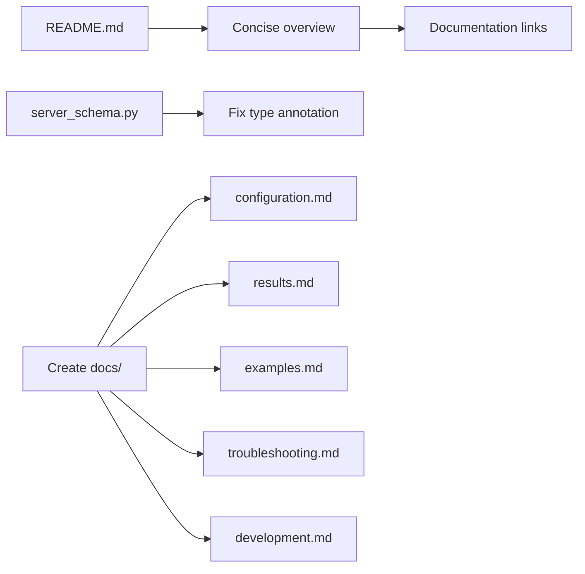

# Issue

**Title:** Docs update

## Description

### **PR Type**
Documentation, Enhancement

___

### **Description**
- Restructure README into concise overview with documentation links

- Fix mypy type annotation error in server schema

- Bump version to 0.9.1

- Create comprehensive documentation structure with separate files

___

### Diagram Walkthrough

 
<h3> File Walkthrough</h3>

<table><thead><tr><th></th><th align="left">Relevant files</th></tr></thead><tbody><tr><td><strong>Configuration changes</strong></td><td>

1 files
<table>
<tr>
  <td><strong>__init__.py</strong><dd><code>Bump version to 0.9.1</code>&nbsp; &nbsp; &nbsp; &nbsp; &nbsp; &nbsp; &nbsp; &nbsp; &nbsp; &nbsp; &nbsp; &nbsp; &nbsp; &nbsp; &nbsp; &nbsp; &nbsp; &nbsp; &nbsp; &nbsp; &nbsp; &nbsp; &nbsp; &nbsp; &nbsp; &nbsp; &nbsp; &nbsp; &nbsp; &nbsp; &nbsp; &nbsp; &nbsp; &nbsp; &nbsp; &nbsp; </dd></td>
  <td><a href="">+1/-1</a>&nbsp; &nbsp; &nbsp; </td>

</tr>
</table>
</td></tr><tr><td><strong>Bug fix</strong></td><td>

1 files
<table>
<tr>
  <td><strong>server_schema.py</strong><dd><code>Fix mypy type annotation for targetAgents</code>&nbsp; &nbsp; &nbsp; &nbsp; &nbsp; &nbsp; &nbsp; &nbsp; &nbsp; &nbsp; &nbsp; &nbsp; &nbsp; &nbsp; &nbsp; &nbsp; </dd></td>
  <td><a href="">+2/-1</a>&nbsp; &nbsp; &nbsp; </td>

</tr>
</table>
</td></tr><tr><td><strong>Documentation</strong></td><td>

8 files
<table>
<tr>
  <td><strong>README.md</strong><dd><code>Restructure to concise overview with doc links</code>&nbsp; &nbsp; &nbsp; &nbsp; &nbsp; &nbsp; &nbsp; &nbsp; &nbsp; &nbsp; &nbsp; </dd></td>
  <td><a href="">+23/-427</a></td>

</tr>

<tr>
  <td><strong>configuration.md</strong><dd><code>Create configuration documentation</code>&nbsp; &nbsp; &nbsp; &nbsp; &nbsp; &nbsp; &nbsp; &nbsp; &nbsp; &nbsp; &nbsp; &nbsp; &nbsp; &nbsp; &nbsp; &nbsp; &nbsp; &nbsp; &nbsp; &nbsp; &nbsp; &nbsp; &nbsp; </dd></td>
  <td><a href="">+67/-0</a>&nbsp; &nbsp; </td>

</tr>

<tr>
  <td><strong>development.md</strong><dd><code>Create development setup documentation</code>&nbsp; &nbsp; &nbsp; &nbsp; &nbsp; &nbsp; &nbsp; &nbsp; &nbsp; &nbsp; &nbsp; &nbsp; &nbsp; &nbsp; &nbsp; &nbsp; &nbsp; &nbsp; &nbsp; </dd></td>
  <td><a href="">+23/-0</a>&nbsp; &nbsp; </td>

</tr>

<tr>
  <td><strong>examples.md</strong><dd><code>Create examples and notebooks documentation</code>&nbsp; &nbsp; &nbsp; &nbsp; &nbsp; &nbsp; &nbsp; &nbsp; &nbsp; &nbsp; &nbsp; &nbsp; &nbsp; &nbsp; </dd></td>
  <td><a href="">+38/-0</a>&nbsp; &nbsp; </td>

</tr>

<tr>
  <td><strong>ollama.md</strong><dd><code>Fix parameter name in Ollama example</code>&nbsp; &nbsp; &nbsp; &nbsp; &nbsp; &nbsp; &nbsp; &nbsp; &nbsp; &nbsp; &nbsp; &nbsp; &nbsp; &nbsp; &nbsp; &nbsp; &nbsp; &nbsp; &nbsp; &nbsp; &nbsp; </dd></td>
  <td><a href="">+2/-2</a>&nbsp; &nbsp; &nbsp; </td>

</tr>

<tr>
  <td><strong>results.md</strong><dd><code>Create results access documentation</code>&nbsp; &nbsp; &nbsp; &nbsp; &nbsp; &nbsp; &nbsp; &nbsp; &nbsp; &nbsp; &nbsp; &nbsp; &nbsp; &nbsp; &nbsp; &nbsp; &nbsp; &nbsp; &nbsp; &nbsp; &nbsp; &nbsp; </dd></td>
  <td><a href="">+35/-0</a>&nbsp; &nbsp; </td>

</tr>

<tr>
  <td><strong>server-overview.md</strong><dd><code>Create server architecture overview documentation</code>&nbsp; &nbsp; &nbsp; &nbsp; &nbsp; &nbsp; &nbsp; &nbsp; </dd></td>
  <td><a href="">+34/-0</a>&nbsp; &nbsp; </td>

</tr>

<tr>
  <td><strong>troubleshooting.md</strong><dd><code>Create troubleshooting guide documentation</code>&nbsp; &nbsp; &nbsp; &nbsp; &nbsp; &nbsp; &nbsp; &nbsp; &nbsp; &nbsp; &nbsp; &nbsp; &nbsp; &nbsp; &nbsp; </dd></td>
  <td><a href="">+6/-0</a>&nbsp; &nbsp; &nbsp; </td>

</tr>
</table>
</td></tr></tr></tbody></table>

___

## Task

Modify the repository so that the issue described above is resolved. The repository is checked out at base commit `9d9e6c439d4b`. Edit files in place; the verifier captures your changes via `git diff` and scores them against an oracle patch using SWE-RL-style diff-similarity reward.