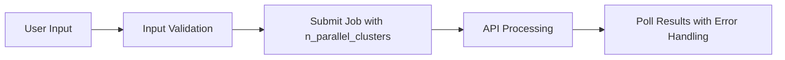

# Issue

**Title:** n_parallel_clusters support and deps update

## Description

### **PR Type**
Enhancement, Other

___

### **Description**
- Add `n_parallel_clusters` parameter for concurrent model requests

- Update dependencies and version bump to 0.10.0

- Improve error handling for empty API responses

- Add input validation using Pydantic models

___

### Diagram Walkthrough

 
<h3> File Walkthrough</h3>

<table><thead><tr><th></th><th align="left">Relevant files</th></tr></thead><tbody><tr><td><strong>Miscellaneous</strong></td><td><table>
<tr>
  <td>
    

      
<strong>__init__.py</strong><dd><code>Version bump to 0.10.0</code>&nbsp; &nbsp; &nbsp; &nbsp; &nbsp; &nbsp; &nbsp; &nbsp; &nbsp; &nbsp; &nbsp; &nbsp; &nbsp; &nbsp; &nbsp; &nbsp; &nbsp; &nbsp; &nbsp; &nbsp; &nbsp; &nbsp; &nbsp; &nbsp; &nbsp; &nbsp; &nbsp; &nbsp; &nbsp; &nbsp; &nbsp; &nbsp; &nbsp; &nbsp; &nbsp; </dd>

cytetype/__init__.py

- Bump version from 0.9.2 to 0.10.0

  </td>
  <td><a href="">+1/-1</a>&nbsp; &nbsp; &nbsp; </td>

</tr>
</table></td></tr><tr><td><strong>Error handling</strong></td><td><table>
<tr>
  <td>
    

      
<strong>client.py</strong><dd><code>Improve API error handling</code>&nbsp; &nbsp; &nbsp; &nbsp; &nbsp; &nbsp; &nbsp; &nbsp; &nbsp; &nbsp; &nbsp; &nbsp; &nbsp; &nbsp; &nbsp; &nbsp; &nbsp; &nbsp; &nbsp; &nbsp; &nbsp; &nbsp; &nbsp; &nbsp; &nbsp; &nbsp; &nbsp; &nbsp; &nbsp; &nbsp; &nbsp; </dd>

cytetype/client.py

<ul><li>Add error handling for empty API responses  <li> Raise <code>CyteTypeAPIError</code> when no response received</ul>

  </td>
  <td><a href="">+2/-0</a>&nbsp; &nbsp; &nbsp; </td>

</tr>
</table></td></tr><tr><td><strong>Enhancement</strong></td><td><table>
<tr>
  <td>
    

      
<strong>main.py</strong><dd><code>Add parallel processing and input validation</code>&nbsp; &nbsp; &nbsp; &nbsp; &nbsp; &nbsp; &nbsp; &nbsp; &nbsp; &nbsp; &nbsp; &nbsp; &nbsp; </dd>

cytetype/main.py

<ul><li>Add <code>n_parallel_clusters</code> parameter to <code>run</code> method  <li> Add input validation using Pydantic models  <li> Import <code>InputData</code> schema for validation  <li> Refactor LLM config validation logic</ul>

  </td>
  <td><a href="">+21/-2</a>&nbsp; &nbsp; </td>

</tr>

<tr>
  <td>
    

      
<strong>server_schema.py</strong><dd><code>Add parallel clusters schema field</code>&nbsp; &nbsp; &nbsp; &nbsp; &nbsp; &nbsp; &nbsp; &nbsp; &nbsp; &nbsp; &nbsp; &nbsp; &nbsp; &nbsp; &nbsp; &nbsp; &nbsp; &nbsp; &nbsp; &nbsp; &nbsp; &nbsp; &nbsp; </dd>

cytetype/server_schema.py

<ul><li>Add <code>nParallelClusters</code> field to <code>InputData</code> model  <li> Set constraints: minimum 1, maximum 50, default 2  <li> Update example data with parallel clusters value</ul>

  </td>
  <td><a href="">+7/-0</a>&nbsp; &nbsp; &nbsp; </td>

</tr>
</table></td></tr><tr><td><strong>Dependencies</strong></td><td><table>
<tr>
  <td>
    

      
<strong>pyproject.toml</strong><dd><code>Update project dependencies</code>&nbsp; &nbsp; &nbsp; &nbsp; &nbsp; &nbsp; &nbsp; &nbsp; &nbsp; &nbsp; &nbsp; &nbsp; &nbsp; &nbsp; &nbsp; &nbsp; &nbsp; &nbsp; &nbsp; &nbsp; &nbsp; &nbsp; &nbsp; &nbsp; &nbsp; &nbsp; &nbsp; &nbsp; &nbsp; &nbsp; </dd>

pyproject.toml

<ul><li>Update <code>anndata</code> dependency from ~0.11.4 to >=0.9.2  <li> Update <code>requests</code> from ~2.32.3 to ~2.32.5  <li> Update all dev dependencies to latest versions  <li> Change mypy Python version from 3.12 to 3.11</ul>

  </td>
  <td><a href="">+9/-9</a>&nbsp; &nbsp; &nbsp; </td>

</tr>
</table></td></tr></tr></tbody></table>

___

## Task

Modify the repository so that the issue described above is resolved. The repository is checked out at base commit `1b865113efbc`. Edit files in place; the verifier captures your changes via `git diff` and scores them against an oracle patch using SWE-RL-style diff-similarity reward.