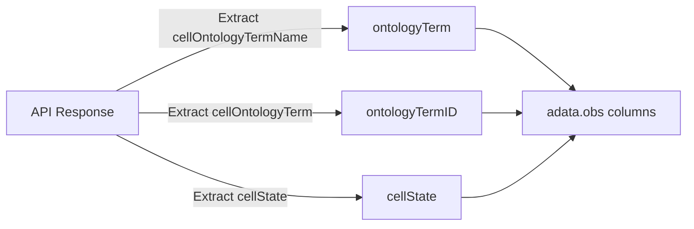

# Issue

**Title:** Add ontology term name and cell state to obs

## Description

### **PR Type**
Enhancement

___

### **Description**
- Add ontology term IDs and cell states to obs columns

- Separate ontology term names from IDs in API response

- Update API domain to production endpoint

- Improve documentation with visualization examples

___

### Diagram Walkthrough

 
<h3> File Walkthrough</h3>

<table><thead><tr><th></th><th align="left">Relevant files</th></tr></thead><tbody><tr><td><strong>Configuration changes</strong></td><td><table>
<tr>
  <td>
    

      
<strong>__init__.py</strong><dd><code>Version bump to 0.11.0</code>&nbsp; &nbsp; &nbsp; &nbsp; &nbsp; &nbsp; &nbsp; &nbsp; &nbsp; &nbsp; &nbsp; &nbsp; &nbsp; &nbsp; &nbsp; &nbsp; &nbsp; &nbsp; &nbsp; &nbsp; &nbsp; &nbsp; &nbsp; &nbsp; &nbsp; &nbsp; &nbsp; &nbsp; &nbsp; &nbsp; &nbsp; &nbsp; &nbsp; &nbsp; &nbsp; </dd>

cytetype/__init__.py

- Version bump from 0.10.0 to 0.11.0

  </td>
  <td><a href="">+1/-1</a>&nbsp; &nbsp; &nbsp; </td>

</tr>

<tr>
  <td>
    

      
<strong>config.py</strong><dd><code>Update API domain to production endpoint</code>&nbsp; &nbsp; &nbsp; &nbsp; &nbsp; &nbsp; &nbsp; &nbsp; &nbsp; &nbsp; &nbsp; &nbsp; &nbsp; &nbsp; &nbsp; &nbsp; &nbsp; </dd>

cytetype/config.py

<ul><li>Update DEFAULT_API_URL from Modal endpoint to production domain  <li> Change from <code>https://nygen-labs-prod--cytetype-api.modal.run</code> to  <code>https://prod.cytetype.nygen.io</code></ul>

  </td>
  <td><a href="">+1/-1</a>&nbsp; &nbsp; &nbsp; </td>

</tr>
</table></td></tr><tr><td><strong>Enhancement</strong></td><td><table>
<tr>
  <td>
    

      
<strong>api.py</strong><dd><code>Separate ontology term names and IDs</code>&nbsp; &nbsp; &nbsp; &nbsp; &nbsp; &nbsp; &nbsp; &nbsp; &nbsp; &nbsp; &nbsp; &nbsp; &nbsp; &nbsp; &nbsp; &nbsp; &nbsp; &nbsp; &nbsp; &nbsp; &nbsp; </dd>

cytetype/api.py

<ul><li>Split ontology term extraction into two fields: <code>ontologyTerm</code> (name)  and <code>ontologyTermID</code> (ID)  <li> Extract <code>cellOntologyTermName</code> for term names  <li> Extract <code>cellOntologyTerm</code> for term IDs</ul>

  </td>
  <td><a href="">+3/-0</a>&nbsp; &nbsp; &nbsp; </td>

</tr>

<tr>
  <td>
    

      
<strong>main.py</strong><dd><code>Store ontology IDs and cell states in obs</code>&nbsp; &nbsp; &nbsp; &nbsp; &nbsp; &nbsp; &nbsp; &nbsp; &nbsp; &nbsp; &nbsp; &nbsp; &nbsp; &nbsp; &nbsp; &nbsp; </dd>

cytetype/main.py

<ul><li>Add ontology term ID mapping to <code>adata.obs</code> with key  <code>{results_prefix}_cellOntologyTermID_{group_key}</code>  <li> Add cell state mapping to <code>adata.obs</code> with key  <code>{results_prefix}_cellState_{group_key}</code>  <li> Update success log message to include new columns</ul>

  </td>
  <td><a href="">+27/-0</a>&nbsp; &nbsp; </td>

</tr>
</table></td></tr><tr><td><strong>Documentation</strong></td><td><table>
<tr>
  <td>
    

      
<strong>README.md</strong><dd><code>Update docs with improved examples</code>&nbsp; &nbsp; &nbsp; &nbsp; &nbsp; &nbsp; &nbsp; &nbsp; &nbsp; &nbsp; &nbsp; &nbsp; &nbsp; &nbsp; &nbsp; &nbsp; &nbsp; &nbsp; &nbsp; &nbsp; &nbsp; &nbsp; &nbsp; </dd>

README.md

<ul><li>Update example API domain URL from Modal to production  <li> Improve code example with variable <code>group_key</code> for reusability  <li> Add UMAP visualization step to pipeline  <li> Update visualization examples to show all four annotation columns</ul>

  </td>
  <td><a href="">+13/-7</a>&nbsp; &nbsp; </td>

</tr>

<tr>
  <td>
    

      
<strong>examples.md</strong><dd><code>Update all report links to production domain</code>&nbsp; &nbsp; &nbsp; &nbsp; &nbsp; &nbsp; &nbsp; &nbsp; &nbsp; &nbsp; &nbsp; &nbsp; &nbsp; </dd>

docs/examples.md

<ul><li>Replace all Modal API URLs with production domain across multiple  dataset links  <li> Update 16 report links to use <code>https://prod.cytetype.nygen.io</code></ul>

  </td>
  <td><a href="">+20/-20</a>&nbsp; </td>

</tr>
</table></td></tr></tr></tbody></table>

___

## Task

Modify the repository so that the issue described above is resolved. The repository is checked out at base commit `dacf0a0d497d`. Edit files in place; the verifier captures your changes via `git diff` and scores them against an oracle patch using SWE-RL-style diff-similarity reward.