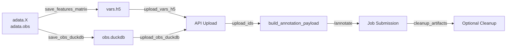

# Issue

**Title:** Feature matrix and observation data artefacts

## Description

### **PR Type**
Enhancement

___

### **Description**
- Automatic artifact packaging and upload before annotation
  - Creates `vars.h5` from normalized counts matrix
  - Creates `obs.duckdb` from observation metadata
  - Uploads both artifacts to API and injects upload IDs into payload

- New API schemas and transport layer for file uploads
  - Added `UploadResponse`, `UploadedFiles`, `AnnotateRequest` schemas
  - Implemented `post_binary()` method for binary file uploads
  - Added `upload_obs_duckdb()` and `upload_vars_h5()` client functions

- Version management and update notifications
  - Bumped version to 0.14.0
  - Added PyPI version check on import with user warnings

- Enhanced run() with artifact lifecycle management
  - New parameters for artifact paths, upload timeout, cleanup control
  - Optional automatic cleanup of generated files after completion

___

### Diagram Walkthrough

<h3>File Walkthrough</h3>

<table><thead><tr><th></th><th align="left">Relevant files</th></tr></thead><tbody><tr><td><strong>Enhancement</strong></td><td>

8 files
<table>
<tr>
  <td><strong>__init__.py</strong><dd><code>Version bump and PyPI update check</code>&nbsp; &nbsp; &nbsp; &nbsp; &nbsp; &nbsp; &nbsp; &nbsp; &nbsp; &nbsp; &nbsp; &nbsp; &nbsp; &nbsp; &nbsp; &nbsp; &nbsp; &nbsp; &nbsp; &nbsp; &nbsp; &nbsp; &nbsp; </dd></td>
  <td><a href="">+44/-1</a>&nbsp; &nbsp; </td>

</tr>

<tr>
  <td><strong>__init__.py</strong><dd><code>Export new upload and request schemas</code>&nbsp; &nbsp; &nbsp; &nbsp; &nbsp; &nbsp; &nbsp; &nbsp; &nbsp; &nbsp; &nbsp; &nbsp; &nbsp; &nbsp; &nbsp; &nbsp; &nbsp; &nbsp; &nbsp; &nbsp; </dd></td>
  <td><a href="">+12/-1</a>&nbsp; &nbsp; </td>

</tr>

<tr>
  <td><strong>client.py</strong><dd><code>Add file upload functions with size validation</code>&nbsp; &nbsp; &nbsp; &nbsp; &nbsp; &nbsp; &nbsp; &nbsp; &nbsp; &nbsp; &nbsp; </dd></td>
  <td><a href="">+56/-0</a>&nbsp; &nbsp; </td>

</tr>

<tr>
  <td><strong>schemas.py</strong><dd><code>New schemas for uploads and client info</code>&nbsp; &nbsp; &nbsp; &nbsp; &nbsp; &nbsp; &nbsp; &nbsp; &nbsp; &nbsp; &nbsp; &nbsp; &nbsp; &nbsp; &nbsp; &nbsp; &nbsp; &nbsp; </dd></td>
  <td><a href="">+50/-1</a>&nbsp; &nbsp; </td>

</tr>

<tr>
  <td><strong>transport.py</strong><dd><code>Add binary POST method for file uploads</code>&nbsp; &nbsp; &nbsp; &nbsp; &nbsp; &nbsp; &nbsp; &nbsp; &nbsp; &nbsp; &nbsp; &nbsp; &nbsp; &nbsp; &nbsp; &nbsp; &nbsp; &nbsp; </dd></td>
  <td><a href="">+30/-4</a>&nbsp; &nbsp; </td>

</tr>

<tr>
  <td><strong>artifacts.py</strong><dd><code>New module for matrix and metadata serialization</code>&nbsp; &nbsp; &nbsp; &nbsp; &nbsp; &nbsp; &nbsp; &nbsp; &nbsp; </dd></td>
  <td><a href="">+108/-0</a>&nbsp; </td>

</tr>

<tr>
  <td><strong>payload.py</strong><dd><code>Support uploaded file references in payload</code>&nbsp; &nbsp; &nbsp; &nbsp; &nbsp; &nbsp; &nbsp; &nbsp; &nbsp; &nbsp; &nbsp; &nbsp; &nbsp; &nbsp; </dd></td>
  <td><a href="">+31/-8</a>&nbsp; &nbsp; </td>

</tr>

<tr>
  <td><strong>main.py</strong><dd><code>Integrate artifact build/upload into run() flow</code>&nbsp; &nbsp; &nbsp; &nbsp; &nbsp; &nbsp; &nbsp; &nbsp; &nbsp; &nbsp; </dd></td>
  <td><a href="">+129/-29</a></td>

</tr>
</table>
</td></tr><tr><td><strong>Tests</strong></td><td>

1 files
<table>
<tr>
  <td><strong>test_cytetype_integration.py</strong><dd><code>Add tests for artifact upload and cleanup</code>&nbsp; &nbsp; &nbsp; &nbsp; &nbsp; &nbsp; &nbsp; &nbsp; &nbsp; &nbsp; &nbsp; &nbsp; &nbsp; &nbsp; &nbsp; &nbsp; </dd></td>
  <td><a href="">+102/-0</a>&nbsp; </td>

</tr>
</table>
</td></tr><tr><td><strong>Documentation</strong></td><td>

3 files
<table>
<tr>
  <td><strong>README.md</strong><dd><code>Document automatic artifact handling</code>&nbsp; &nbsp; &nbsp; &nbsp; &nbsp; &nbsp; &nbsp; &nbsp; &nbsp; &nbsp; &nbsp; &nbsp; &nbsp; &nbsp; &nbsp; &nbsp; &nbsp; &nbsp; &nbsp; &nbsp; &nbsp; </dd></td>
  <td><a href="">+3/-0</a>&nbsp; &nbsp; &nbsp; </td>

</tr>

<tr>
  <td><strong>configuration.md</strong><dd><code>Add artifact pipeline and memory recommendations</code>&nbsp; &nbsp; &nbsp; &nbsp; &nbsp; &nbsp; &nbsp; &nbsp; &nbsp; </dd></td>
  <td><a href="">+23/-1</a>&nbsp; &nbsp; </td>

</tr>

<tr>
  <td><strong>troubleshooting.md</strong><dd><code>Add artifact and memory troubleshooting tips</code>&nbsp; &nbsp; &nbsp; &nbsp; &nbsp; &nbsp; &nbsp; &nbsp; &nbsp; &nbsp; &nbsp; &nbsp; &nbsp; </dd></td>
  <td><a href="">+3/-1</a>&nbsp; &nbsp; &nbsp; </td>

</tr>
</table>
</td></tr><tr><td><strong>Dependencies</strong></td><td>

1 files
<table>
<tr>
  <td><strong>pyproject.toml</strong><dd><code>Add duckdb and hdf5plugin dependencies</code>&nbsp; &nbsp; &nbsp; &nbsp; &nbsp; &nbsp; &nbsp; &nbsp; &nbsp; &nbsp; &nbsp; &nbsp; &nbsp; &nbsp; &nbsp; &nbsp; &nbsp; &nbsp; &nbsp; </dd></td>
  <td><a href="">+3/-1</a>&nbsp; &nbsp; &nbsp; </td>

</tr>
</table>
</td></tr></tbody></table>

___

## Task

Modify the repository so that the issue described above is resolved. The repository is checked out at base commit `ae7bc7141259`. Edit files in place; the verifier captures your changes via `git diff` and scores them against an oracle patch using SWE-RL-style diff-similarity reward.