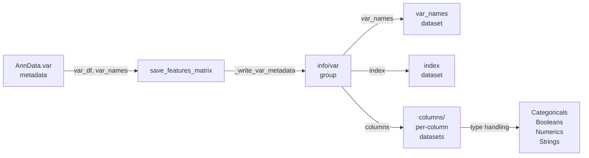

# Issue

**Title:** Save var metadata to vars.h5

## Description

### **User description**
Persist AnnData.var metadata into the vars.h5 artifact. Bump package version to 0.14.1 and add helpers to artifacts.py to safely name column datasets, coerce values to strings, and write var metadata (var_names, index, and per-column datasets) into info/var/columns. Handles categoricals, booleans (with a missing sentinel), numeric and string types and validates row/column counts. Update save_features_matrix signature/callsites to accept var_df and var_names and write metadata when provided, and add a unit test (tests/test_artifacts.py) to verify the written structure and attributes.

___

### **PR Type**
Enhancement

___

### **Description**
- Persist AnnData.var metadata into vars.h5 artifact structure

- Add helper functions for safe column naming and type coercion

- Handle diverse data types: categoricals, booleans, numerics, strings

- Update save_features_matrix to accept and write var metadata

- Add comprehensive unit test for var metadata persistence

___

### Diagram Walkthrough

<h3>File Walkthrough</h3>

<table><thead><tr><th></th><th align="left">Relevant files</th></tr></thead><tbody><tr><td><strong>Configuration changes</strong></td><td><table>
<tr>
  <td>
    

      
<strong>__init__.py</strong><dd><code>Version bump to 0.14.1</code>&nbsp; &nbsp; &nbsp; &nbsp; &nbsp; &nbsp; &nbsp; &nbsp; &nbsp; &nbsp; &nbsp; &nbsp; &nbsp; &nbsp; &nbsp; &nbsp; &nbsp; &nbsp; &nbsp; &nbsp; &nbsp; &nbsp; &nbsp; &nbsp; &nbsp; &nbsp; &nbsp; &nbsp; &nbsp; &nbsp; &nbsp; &nbsp; &nbsp; &nbsp; &nbsp; </dd>

cytetype/__init__.py

- Bump package version from 0.14.0 to 0.14.1

  </td>
  <td><a href="">+1/-1</a>&nbsp; &nbsp; &nbsp; </td>

</tr>
</table></td></tr><tr><td><strong>Enhancement</strong></td><td><table>
<tr>
  <td>
    

      
<strong>artifacts.py</strong><dd><code>Add var metadata persistence to HDF5 artifacts</code>&nbsp; &nbsp; &nbsp; &nbsp; &nbsp; &nbsp; &nbsp; &nbsp; &nbsp; &nbsp; &nbsp; </dd>

cytetype/core/artifacts.py

<ul><li>Add <code>_safe_column_dataset_name()</code> to generate unique HDF5-safe dataset  names with collision handling  <li> Add <code>_as_string_values()</code> to coerce Series/Index/Sequence values to  string arrays  <li> Add <code>_write_var_metadata()</code> to persist var metadata with type-specific  handling for categoricals, booleans with missing sentinel, numerics,  and strings  <li> Update <code>save_features_matrix()</code> signature to accept optional <code>var_df</code> and  <code>var_names</code> parameters  <li> Integrate metadata writing into save_features_matrix workflow when  var_df is provided</ul>

  </td>
  <td><a href="">+112/-1</a>&nbsp; </td>

</tr>

<tr>
  <td>
    

      
<strong>main.py</strong><dd><code>Pass var metadata to artifact builder</code>&nbsp; &nbsp; &nbsp; &nbsp; &nbsp; &nbsp; &nbsp; &nbsp; &nbsp; &nbsp; &nbsp; &nbsp; &nbsp; &nbsp; &nbsp; &nbsp; &nbsp; &nbsp; &nbsp; &nbsp; </dd>

cytetype/main.py

<ul><li>Pass <code>self.adata.var</code> and <code>self.adata.var_names</code> to <code>save_features_matrix()</code>  call in <code>_build_and_upload_artifacts()</code></ul>

  </td>
  <td><a href="">+2/-0</a>&nbsp; &nbsp; &nbsp; </td>

</tr>
</table></td></tr><tr><td><strong>Tests</strong></td><td><table>
<tr>
  <td>
    

      
<strong>test_artifacts.py</strong><dd><code>Add unit test for var metadata persistence</code>&nbsp; &nbsp; &nbsp; &nbsp; &nbsp; &nbsp; &nbsp; &nbsp; &nbsp; &nbsp; &nbsp; &nbsp; &nbsp; &nbsp; &nbsp; </dd>

tests/test_artifacts.py

<ul><li>Add new test file with <code>test_save_features_matrix_writes_var_metadata()</code>  function  <li> Verify HDF5 structure: info/var/var_names, info/var/index,  info/var/columns groups  <li> Validate dataset counts match AnnData dimensions  <li> Confirm source_name and source_dtype attributes are written for each  column</ul>

  </td>
  <td><a href="">+34/-0</a>&nbsp; &nbsp; </td>

</tr>
</table></td></tr></tbody></table>

___

## Task

Modify the repository so that the issue described above is resolved. The repository is checked out at base commit `b9b75571259d`. Edit files in place; the verifier captures your changes via `git diff` and scores them against an oracle patch using SWE-RL-style diff-similarity reward.