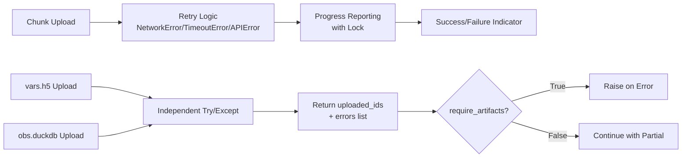

# Issue

**Title:** Retry chunk uploads and allow partial artifacts

## Description

### **User description**
Add robust retry and progress reporting for chunk uploads: import NetworkError, define retryable API codes and retry delays, retry on NetworkError/TimeoutError/APIError (certain codes), and print progress and final success/failure indicators. Update wait_for_completion to use logger.success for completed jobs. Improve log formatting (icons and colored success) via a custom _log_format and TYPE_CHECKING annotations. Change result logging to a clearer info block mapping annotation outputs to adata locations. Refactor artifact build/upload to return (uploaded, errors), handle vars.h5 and obs.duckdb as independent uploads with per-artifact try/except and warnings, and surface errors when require_artifacts=True. Adjust integration test to expect partial uploads behavior.

___

### **PR Type**
Enhancement, Bug fix

___

### **Description**
- Add retry logic for chunk uploads with exponential backoff delays

- Handle artifact uploads independently with per-artifact error tracking

- Improve logging with custom formatting (icons, colors, structured output)

- Allow partial artifact uploads when `require_artifacts=False`

___

### Diagram Walkthrough

<h3>File Walkthrough</h3>

<table><thead><tr><th></th><th align="left">Relevant files</th></tr></thead><tbody><tr><td><strong>Configuration changes</strong></td><td><table>
<tr>
  <td>
    

      
<strong>__init__.py</strong><dd><code>Version bump to 0.16.1</code>&nbsp; &nbsp; &nbsp; &nbsp; &nbsp; &nbsp; &nbsp; &nbsp; &nbsp; &nbsp; &nbsp; &nbsp; &nbsp; &nbsp; &nbsp; &nbsp; &nbsp; &nbsp; &nbsp; &nbsp; &nbsp; &nbsp; &nbsp; &nbsp; &nbsp; &nbsp; &nbsp; &nbsp; &nbsp; &nbsp; &nbsp; &nbsp; &nbsp; &nbsp; &nbsp; </dd>

cytetype/__init__.py

- Bump version from 0.16.0 to 0.16.1

  </td>
  <td><a href="">+1/-1</a>&nbsp; &nbsp; &nbsp; </td>

</tr>
</table></td></tr><tr><td><strong>Enhancement</strong></td><td><table>
<tr>
  <td>
    

      
<strong>client.py</strong><dd><code>Add retry logic and progress reporting for chunk uploads</code>&nbsp; </dd>

cytetype/api/client.py

<ul><li>Import <code>NetworkError</code> exception for retry handling  <li> Define <code>_CHUNK_RETRY_DELAYS</code> tuple and <code>_RETRYABLE_API_ERROR_CODES</code>  frozenset for retry logic  <li> Implement retry mechanism in <code>_upload_chunk</code> with exponential backoff  for <code>NetworkError</code>, <code>TimeoutError</code>, and specific <code>APIError</code> codes  <li> Add thread-safe progress tracking with <code>_progress_lock</code> and <code>_chunks_done</code>  counter  <li> Print progress updates and colored success indicator on completion  <li> Ensure newline printed on upload failure</ul>

  </td>
  <td><a href="">+55/-9</a>&nbsp; &nbsp; </td>

</tr>

<tr>
  <td>
    

      
<strong>config.py</strong><dd><code>Implement custom log formatting with icons</code>&nbsp; &nbsp; &nbsp; &nbsp; &nbsp; &nbsp; &nbsp; &nbsp; &nbsp; &nbsp; &nbsp; &nbsp; &nbsp; &nbsp; &nbsp; </dd>

cytetype/config.py

<ul><li>Add <code>TYPE_CHECKING</code> import for type hints  <li> Define custom <code>_log_format</code> function with emoji icons for WARNING and  SUCCESS levels  <li> Apply custom format to logger configuration for improved visual output</ul>

  </td>
  <td><a href="">+18/-2</a>&nbsp; &nbsp; </td>

</tr>

<tr>
  <td>
    

      
<strong>results.py</strong><dd><code>Restructure results logging format</code>&nbsp; &nbsp; &nbsp; &nbsp; &nbsp; &nbsp; &nbsp; &nbsp; &nbsp; &nbsp; &nbsp; &nbsp; &nbsp; &nbsp; &nbsp; &nbsp; &nbsp; &nbsp; &nbsp; &nbsp; &nbsp; &nbsp; &nbsp; </dd>

cytetype/core/results.py

<ul><li>Change <code>logger.success</code> to <code>logger.info</code> for annotation results  <li> Reformat result logging message with aligned arrows and clearer  mapping of outputs to adata locations</ul>

  </td>
  <td><a href="">+6/-6</a>&nbsp; &nbsp; &nbsp; </td>

</tr>

<tr>
  <td>
    

      
<strong>main.py</strong><dd><code>Support independent artifact uploads with error tracking</code>&nbsp; </dd>

cytetype/main.py

<ul><li>Refactor <code>_build_and_upload_artifacts</code> to return tuple of <code>(uploaded_ids, </code> <code>errors)</code> instead of raising on first failure  <li> Wrap vars.h5 and obs.duckdb uploads in independent try/except blocks  to allow partial success  <li> Log warnings for individual artifact failures instead of raising  immediately  <li> Update <code>run</code> method to handle partial uploads: only include successfully  uploaded artifacts in payload  <li> Surface artifact errors only when <code>require_artifacts=True</code>, otherwise  continue with warning  <li> Add print statements for visual separation between artifact and job  submission phases</ul>

  </td>
  <td><a href="">+73/-52</a>&nbsp; </td>

</tr>
</table></td></tr><tr><td><strong>Tests</strong></td><td><table>
<tr>
  <td>
    

      
<strong>test_cytetype_integration.py</strong><dd><code>Update test for partial artifact uploads</code>&nbsp; &nbsp; &nbsp; &nbsp; &nbsp; &nbsp; &nbsp; &nbsp; &nbsp; &nbsp; &nbsp; &nbsp; &nbsp; &nbsp; &nbsp; &nbsp; &nbsp; </dd>

tests/test_cytetype_integration.py

<ul><li>Update test docstring to reflect partial upload behavior  <li> Change assertion to expect <code>obs_duckdb</code> in payload when vars.h5 fails  but obs.duckdb succeeds  <li> Document that vars.h5 save fails independently while obs.duckdb still  succeeds</ul>

  </td>
  <td><a href="">+6/-3</a>&nbsp; &nbsp; &nbsp; </td>

</tr>
</table></td></tr></tbody></table>

___

## Task

Modify the repository so that the issue described above is resolved. The repository is checked out at base commit `bee38ca8f1bd`. Edit files in place; the verifier captures your changes via `git diff` and scores them against an oracle patch using SWE-RL-style diff-similarity reward.