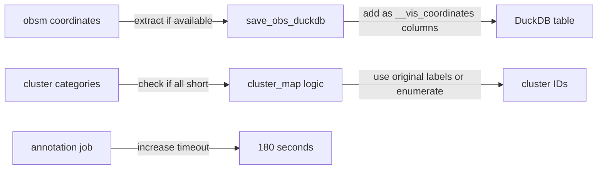

# Issue

**Title:** Obsm in duckdb

## Description

### **PR Type**
Enhancement

___

### **Description**
- Store observation coordinates in DuckDB artifact

- Improved cluster ID mapping logic for short values

- Increased annotation job timeout to 180 seconds

- Version bump to 0.17.0

___

### Diagram Walkthrough

<h3>File Walkthrough</h3>

<table><thead><tr><th></th><th align="left">Relevant files</th></tr></thead><tbody><tr><td><strong>Configuration changes</strong></td><td><table>
<tr>
  <td>
    

      
<strong>__init__.py</strong><dd><code>Version bump to 0.17.0</code>&nbsp; &nbsp; &nbsp; &nbsp; &nbsp; &nbsp; &nbsp; &nbsp; &nbsp; &nbsp; &nbsp; &nbsp; &nbsp; &nbsp; &nbsp; &nbsp; &nbsp; &nbsp; &nbsp; &nbsp; &nbsp; &nbsp; &nbsp; &nbsp; &nbsp; &nbsp; &nbsp; &nbsp; &nbsp; &nbsp; &nbsp; &nbsp; &nbsp; &nbsp; &nbsp; </dd>

cytetype/__init__.py

- Version bumped from 0.16.1 to 0.17.0

  </td>
  <td><a href="">+1/-1</a>&nbsp; &nbsp; &nbsp; </td>

</tr>
</table></td></tr><tr><td><strong>Enhancement</strong></td><td><table>
<tr>
  <td>
    

      
<strong>client.py</strong><dd><code>Increase annotation timeout to 180 seconds</code>&nbsp; &nbsp; &nbsp; &nbsp; &nbsp; &nbsp; &nbsp; &nbsp; &nbsp; &nbsp; &nbsp; &nbsp; &nbsp; &nbsp; &nbsp; </dd>

cytetype/api/client.py

- Increased annotation job submission timeout from 60 to 180 seconds

  </td>
  <td><a href="">+1/-1</a>&nbsp; &nbsp; &nbsp; </td>

</tr>

<tr>
  <td>
    

      
<strong>artifacts.py</strong><dd><code>Add obsm coordinates storage to DuckDB</code>&nbsp; &nbsp; &nbsp; &nbsp; &nbsp; &nbsp; &nbsp; &nbsp; &nbsp; &nbsp; &nbsp; &nbsp; &nbsp; &nbsp; &nbsp; &nbsp; &nbsp; &nbsp; &nbsp; </dd>

cytetype/core/artifacts.py

<ul><li>Added <code>obsm_coordinates</code> and <code>coordinates_key</code> parameters to  <code>save_obs_duckdb</code> function  <li> Extract coordinate dimensions and store as <code>__vis_coordinates_{key}_1</code>  and <code>__vis_coordinates_{key}_2</code> columns in obs DataFrame</ul>

  </td>
  <td><a href="">+7/-0</a>&nbsp; &nbsp; &nbsp; </td>

</tr>

<tr>
  <td>
    

      
<strong>main.py</strong><dd><code>Implement smart cluster ID mapping and coordinate passing</code></dd>

cytetype/main.py

<ul><li>Modified cluster ID mapping to use original labels if all are short  (<=3 chars), otherwise enumerate from 0  <li> Pass <code>coordinates_key</code> to <code>_build_and_upload_artifacts</code> method  <li> Extract obsm coordinates and pass to <code>save_obs_duckdb_file</code> function  <li> Added logic to check coordinate availability before extraction</ul>

  </td>
  <td><a href="">+16/-2</a>&nbsp; &nbsp; </td>

</tr>
</table></td></tr></tbody></table>

___

## Task

Modify the repository so that the issue described above is resolved. The repository is checked out at base commit `fab67118cfc2`. Edit files in place; the verifier captures your changes via `git diff` and scores them against an oracle patch using SWE-RL-style diff-similarity reward.